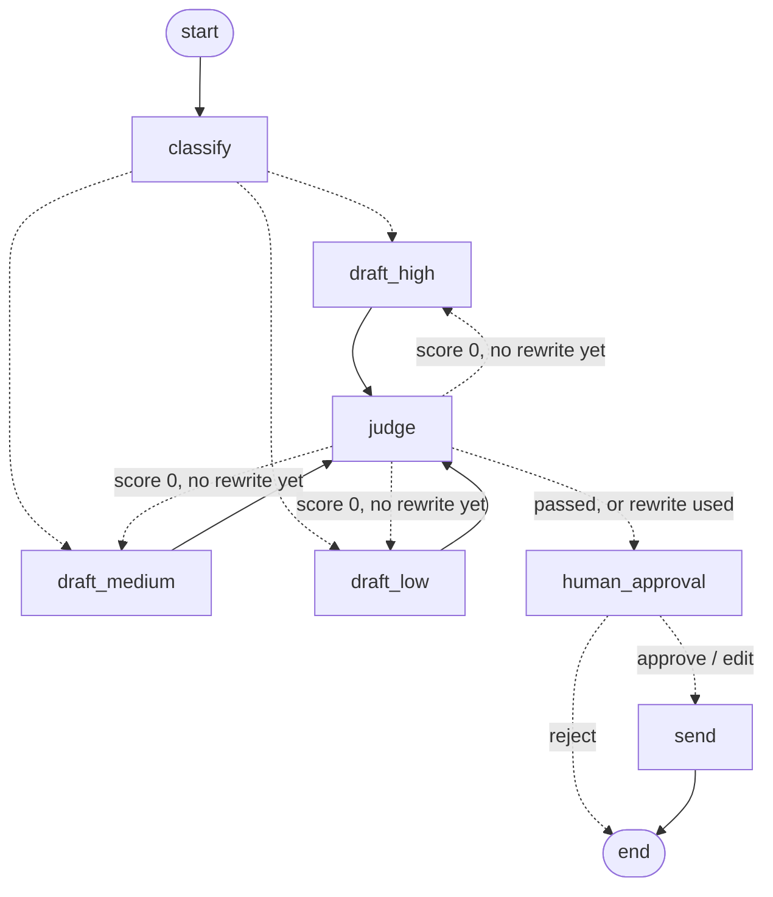

# 🚀 Signup Email Agent

This project uses AI to welcome new users. When someone signs up, the agent decides how good a fit they are as a customer, writes them a personal welcome email, and then checks its own work. A tool called LangSmith keeps a record of every step, and a set of test cases (the "golden dataset") makes sure the emails stay good over time.


## 💡 Use Cases

Any company that gets a lot of signups can use this to **sort new users and welcome them, without doing it all by hand**. For example:

- **Welcome emails right away** — send a personal email the moment someone signs up, based on their job and company size.
- **Help salespeople focus** — send the best-fit signups to a salesperson right away, and give everyone else a friendly automated welcome.
- **Smarter marketing** — save each signup's fit score in a sales tool (like HubSpot or Salesforce) so the right people get the right messages.
- **Small startups** — get a short "who just signed up, and should I reach out?" note for every new user.

To use it for your own product, change the product name (here it's a made-up tool called "Glop") and the rules for what a good customer looks like.

### Example: Ledgerline (a made-up company)

*This company and its numbers are made up to show how the agent could be used.*

**The company.** Ledgerline sells payment tools that software teams plug into their apps. People sign up for a free account to try it. Some of them could become big paying customers.

**The problem.**
- About 1,200 people sign up each week, but there are only 3 salespeople.
- The salespeople can't read every signup. A top engineering boss gets the same plain welcome as a student.
- Important leads wait 2–3 days for a personal reply. Some go to a competitor instead.
- Once, an AI email greeted a finance boss with "Hi there" and used the wrong company name. Now a person must check every email before it goes out.

**How the agent helps.**

| Step | What happens at Ledgerline |
|------|----------------------------|
| Sort (ICP fit) | **High:** an engineering or finance leader at a tech company with 50+ people. **Medium:** a developer anywhere. **Low:** students and very small companies. **Unknown:** only an email address. |
| Write | The email fits the person. Leaders hear how it helps their team grow. Developers hear how fast they can start. Everyone else gets a friendly welcome and a how-to guide. |
| Check and fix | A second AI checks each email. If it sounds generic, the agent rewrites it once. |
| Person approves | Each morning, a salesperson looks over the drafts. They can send, change, or throw out each one. |
| Save and wait | A signup at midnight waits safely until someone logs in. |
| Send and record | Approved emails go out. LangSmith keeps a record of every draft, score, and choice. |

**One signup, start to finish.**
1. Tuesday, 11:40 p.m.: Priya, who leads engineering at an 800-person payments company, signs up.
2. The agent marks her as high fit and writes an email about helping her team.
3. The checker gives it a 0 because it forgot her company's name. The agent rewrites it, and it gets a 1.
4. The run pauses and is saved overnight.
5. Wednesday, 9:05 a.m.: a salesperson adds one line and approves it.
6. Priya gets a personal email that morning instead of 3 days later.

**What could change** (made-up goals):

| | Before | Goal |
|---|---|---|
| Time until a top lead gets a personal reply | 2–3 days | The same morning |
| Time salespeople spend on small signups | Most of the week | A few minutes a day |
| Emails with the wrong name or a plain greeting | Nobody knows | Almost none |
| Record of who approved each email | Search old emails | Every approval saved in LangSmith |

**The big idea:** let the AI do the reading and writing, but keep a person in charge of what gets sent. The same idea works for welcoming new bank clients, answering help tickets, or changing important records.

---

## ⚠️ Why AI Needs Tests

Many teams check their AI by trying it a few times. If it looks fine, they ship it. Weeks later, someone notices the emails sound generic or the sorting is wrong, and nobody knows when it started.

Even a "simple" AI can go wrong in quiet ways:
- A VP of Engineering gets a bland "use our tools" email.
- Someone with no first name gets "Hi ,".
- The CEO of an 8-person startup gets treated the same as a developer at a 500-person company.

None of these cause an error message. The AI keeps running; it just does a worse job. Tests (called **evals**) are how you catch this. This project shows how to build them.

---

**Tools used:** LangChain · LangGraph · LangSmith · DeepEval · OpenAI gpt-4o-mini · Python 3.10+


---

## 📁 Project Files

```
langsmith-signup-email-agent/
├── agent.py          # The original agent, its 6 test cases,
│                     # and the AI checker (the "judge")
├── graph_agent.py    # The same agent built with LangGraph: it can
│                     # rewrite once and waits for a person to approve
├── eval.py           # Tests the agent with DeepEval
├── graph_agent_tools.py  # Copy of graph_agent.py where the AI calls a
│                     # pretend account-lookup tool first
├── graph_eval.py     # Tests graph_agent.py and saves the results
│                     # in LangSmith
├── images/           # Pictures used in this README
├── requirements.txt  # The Python packages you need
├── .env.example      # Copy this to .env and add your keys
├── .env              # Your real keys (never uploaded)
└── .gitignore
```

---

## 🏗️ How the Parts Fit


Each signup uses two AI calls. The first one sorts the signup and writes the email. It must answer in a fixed format (`SignupEmailOutput`), so the program always gets the same fields back. The second call, the **judge**, grades the email: 1 for good, 0 for bad, or n/a when there was nothing to personalize. LangSmith records both calls.

---

## ⚙️ Setup

**1. Install the packages**
```bash
pip install -r requirements.txt
```

**2. Add your keys**
```bash
cp .env.example .env
# Open .env and fill in your keys
```

Your `.env` file should look like this:
```
OPENAI_API_KEY=sk-...
LANGSMITH_API_KEY=lsv2_pt_...
LANGCHAIN_PROJECT=langsmith-signup-email-agent
```

---

## 🚀 Running It

**Run the agent and its tests**
```bash
# Your keys load from .env on their own
python agent.py
```

This runs all 6 test cases. For each one, it prints the email and the judge's score.

**What you should see:**
```
============================================================
TEST: Baseline - High ICP
============================================================
ICP Fit:  high
Subject:  Welcome to Glop, Victor! Elevate Your Engineering Team
Body:
  Hi Victor, Welcome to Glop! As the VP of Engineering at Acme Corp...

⚖️  Personalization Score: 1 — Addresses user by name, role, and company context.

...

PERSONALIZATION SCORE SUMMARY
✅  Baseline - High ICP: 1
✅  Edge: Missing first name: 1
✅  Edge: Generic email domain: 1
✅  Edge: Unclear role: 1
✅  Edge: Stealth company: 1
⏭️   Edge: Incomplete context: n/a

Total: 5/5 (excluding n/a cases)
```

---

## 🧠 How It Works

### 1. Sorting Signups (ICP Fit)
**ICP** means **Ideal Customer Profile**: the kind of person or company most likely to get real value from the product and keep paying for it. **ICP fit** is how closely a new signup matches that picture.

The signup goes to the AI as plain text, one `key: value` per line. Nothing checks the signup first, so missing details (like no first name) reach the AI as they are. The AI's **answer** is checked, though: `SignupEmailOutput` only allows the four fit levels below, and it must return `to`, `reason`, `subject` and `body`.


| ICP fit | Rule | Example from the test cases | What they usually get |
|---------|------|-----------------------------|-----------------------|
| `high` | An engineering or product leader at a tech company with 50+ people | Victor, VP of Engineering, Acme Corp (500 people) | A personal note from a salesperson |
| `medium` | A developer or other technical job, at any company | John, Developer; a Software Engineer at TechCorp | Self-serve help for developers |
| `low` | A non-technical job, or a company with fewer than 10 people | Alex, Associate; Maya, CEO of an 8-person startup | A friendly automated welcome |
| `unknown` | Not enough information | A signup with only an email address | A general welcome |

Salespeople have limited time, so the fit decides who gets what. In this project, the fit also picks the email's **tone**. In `graph_agent.py`, a function called `route_by_tone` makes that choice and picks `draft_high`, `draft_medium` or `draft_low`.

### 2. Writing the Email
Each fit level gets a different message:
- **High** → how Glop helps their whole team work faster and grow
- **Medium** → how Glop speeds up their own work as a developer
- **Low** → warm and simple, no tech words, and always their first name if we have it
- **Unknown** → general and friendly

### 3. The AI Judge
After each email is written, a second AI call (`judge_personalization()`) grades it. The judge only sees the signup and the email. It grades against fixed rules, not a stored "right answer". In `graph_agent.py`, the same judge decides if a draft gets one rewrite.


```
Score 1   → uses the name, mentions their job or company, and explains why Glop helps them
Score 0   → generic greeting even though we had a name, or ignores their job or company
Score n/a → there was nothing to personalize (this is not a failure)
```

---

## 🧪 Testing: Before and After You Ship

This project tests the AI in two ways: before you release a change (**offline**) and while it runs for real (**online**).

### Offline Tests — run these yourself before you change the prompt

```powershell
# Option 1: the 6 test cases in agent.py, graded by the judge
python agent.py

# Option 2: DeepEval tests, using the test cases saved in LangSmith
python eval.py

# Option 3: tests for the LangGraph version, saved in LangSmith
python graph_eval.py
```

**What they do:** each one runs the 6 test cases and grades the results.
- `agent.py` grades each email with the judge (1, 0 or n/a).
- `eval.py` pulls the test cases from LangSmith and grades the fit and the email with DeepEval, another testing tool.
- `graph_eval.py` is explained in the [LangGraph section](#offline-eval-for-the-graph).

**Why:** when you change the prompt, you can compare scores before and after. Think of them as practice tests: run them before every release to catch anything that got worse.

The test cases are saved in LangSmith, with the answer we expect for each one:


**Result: 5/5 ✅** (1 n/a case not counted)

### Online Tests — these run on their own

```
# Nothing to run. Use the agent as normal, and LangSmith grades it.
python agent.py          # or any real use of the agent
```

You see the results on the **LangSmith website**, not in your terminal.

**What it is:** LangSmith runs a checker called `personalization_quality` on every run of the agent. It adds a true/false grade to each run's record.

**How often:** right now it checks 100% of runs, which is fine while building. For a real product, checking about **10%** is enough to see how things are going without paying to check every single run. The checkers cost money too: in the week of Oct 19–25, 2026, the four checkers cost $4.83 across 406 runs, while the agent itself cost $0.01.

**Known problem:** in `agent.py`, the agent call and the judge call are recorded separately. So the online checker also grades the judge's answers, not just the emails. A real setup should only check the agent's runs.

**LangSmith settings:**
- **Checker:** OnlineEval → `personalization_quality`
- **Grade name:** `personalization_quality` (true/false)
- **How often:** 100% now → 10% for a real product
- **Checks:** every run in the `langsmith-signup-email-agent` project

Four AI checkers run in LangSmith. One checks quality (`personalization_quality`), and three check safety: `pii_leakage`, `prompt_injection` and `code_injection` (see [Safety Evaluators](#️-safety-evaluators)).


How each run's record goes from the code into LangSmith, through the checkers, and back into the test cases:


### Why you need both

| | Offline (agent.py) | Online (LangSmith) |
|---|---|---|
| **When it runs** | When you run it, before a change | On its own, every time the agent runs |
| **What it catches** | A prompt change that made things worse | Problems that show up with real users |
| **Where you see results** | A total score in your terminal | A grade on each run in LangSmith |
| **Best for** | Changing the prompt with confidence | Watching quality over time |

Offline tests tell you if a change helped or hurt before you ship it. Online tests tell you if something breaks after. You need both.

---

## 🔄 The Improvement Cycle

```
01 BUILD
   Run the offline tests in agent.py
        ↓
02 RELEASE
   Put the agent to work (for example, on your signup form)
        ↓
03 WATCH
   LangSmith checks real runs on its own
   (about 10% of runs for a real product)
        ↓
04 IMPROVE
   Add real failures to the test cases
   Fix the prompt → run the tests again → check it got better
        ↓ (repeat)
```

**The key idea:** when something goes wrong for a real user, add that case to the test cases. That way your tests get stronger every time something breaks.

---

## 🛡️ Safety Evaluators

Besides checking quality, three more checkers run on their own in LangSmith:

| Checker | What it looks for | What happens |
|---------|-------------------|--------------|
| **PII Leakage** | Private personal information in the signup | Sends the run to a review list for a person to check |
| **Prompt Injection** | Someone trying to trick the AI with sneaky instructions | Marks the run `prompt_injection: true` |
| **Code Injection** | Someone trying to slip in harmful code | Marks the run `code_injection: true` |

When `pii_leakage` is true, a LangSmith rule (PII Alert) sends the run to a review list called `pii-review-queue`, so nobody has to watch for it. Every signup has a name and an email, so right now this checker flags most runs. A real setup should only flag private information that isn't expected.

Keep safety and quality separate. Build one checker for each, instead of one checker that tries to do both.

---

## 💡 Key Takeaways

1. **Real AI products need tests.** Without them, you can't tell if your changes make the AI better or worse.

2. **Start with a small set of test cases.** Even 5 or 6 tricky examples catch most problems. Add a new one every time something breaks.

3. **Test before and after you ship.** Offline tests catch problems before release. Online tests catch problems with real users. You need both.

4. **An AI judge works better than an exact match.** Stored "right answers" go out of date. A judge with clear rules is easier to keep up to date.

5. **Keep safety and quality separate.** Build a different checker for each.

---

## 🕸️ LangGraph Version: Rewrite Once, Then a Person Approves

`graph_agent.py` builds the same agent with LangGraph, a tool for laying out an AI's work as steps. It writes drafts on its own, but nothing is sent until a person approves it.




| Step | What it does |
|------|--------------|
| `classify` | Sorts the signup (ICP fit) and says why |
| `draft_high` / `draft_medium` / `draft_low` | Writes the email in the tone that matches the fit (unknown uses the low tone) |
| `judge` | Grades the draft with `judge_personalization()`. A 0 sends it back with the judge's notes, **one rewrite at most** |
| `human_approval` | Pauses with `interrupt()` and shows the draft to a person |
| `send` | A stand-in for sending: it writes the approved email to `outbox.jsonl`. Nothing is really sent |

Every step reads from and writes to one shared record, called `SignupState`:

| Field | Type | What it holds | Who fills it in |
|-------|------|---------------|-----------------|
| `signup` | `str` (text) | The signup, one `key: value` per line | You, at the start |
| `weak_first_draft` | `bool` (yes/no) | Demo switch: makes the first draft bland on purpose | You, at the start |
| `icp_fit` | `str` (text) | `high`, `medium`, `low` or `unknown` | `classify` |
| `reason` | `str` (text) | One sentence on why | `classify` |
| `subject` | `str` (text) | The email's subject line | `draft_*` |
| `body` | `str` (text) | The email itself | `draft_*`, or the person on `edit` |
| `judge_score` | `int \| str` (number or text) | `1`, `0` or `"n/a"` | `judge` |
| `judge_feedback` | `str` (text) | The judge's notes, given to the rewrite | `judge` |
| `revision_count` | `int` (number) | How many rewrites so far (0 or 1) | `classify` sets 0; `draft_*` adds 1 on a rewrite |
| `decision` | `str` (text) | `approve`, `edit` or `reject` | `human_approval` |

A score of 0 sends the draft back to the **same** writing step it came from (for Alex, `draft_low`), one time. A score of 1 or n/a, or a 0 after the rewrite, goes to `human_approval`.

The run is saved to a small database file (`checkpoints.sqlite`) under an ID called `thread_id`. So a paused run can be picked up later, even after the program closes. LangSmith records every step, and the paused run and the resumed run share the same `thread_id`.

```powershell
# Run one signup until it stops for approval
python graph_agent.py --case alex --weak-first-draft

# Later, finish it. "last" means the most recent paused run
python graph_agent.py --resume last approve
python graph_agent.py --resume last edit --body "Hi Alex, ..."
python graph_agent.py --resume last reject

# See every run waiting for approval, then pick one by its thread_id
python graph_agent.py --pending
python graph_agent.py --resume <thread_id> approve
```

`--weak-first-draft` makes the first draft bland on purpose, so you can watch the judge fail it and the agent rewrite it. Without it, the prompt usually passes on the first try. Other options: `--case` (`victor`, `no-name`, `john`, `alex`, `maya`, `minimal`), `--signup "<your own details>"`, and `--diagram` to print the steps as a diagram.

### Tool calling: looking up the account first

`graph_agent_tools.py` is a copy of the graph with one extra step at the front. The AI **decides on its own** to call a tool, and LangGraph's `ToolNode` runs it:


```
START → lookup ⇄ tools → add_account_info → classify → draft → judge → human_approval → send
```

| Step | What it does |
|------|--------------|
| `lookup` | The AI reads the signup. It has one tool, `get_account_status(email)`, and decides to call it |
| `tools` | A `ToolNode` runs the tool and gives the answer back to the AI |
| `tools_condition` | Checks if the AI asked for a tool: yes → `tools`, no → move on |
| `add_account_info` | Adds the AI's one-line summary (like "account: free trial, 9 days left") to the signup |
| The rest | The same steps as `graph_agent.py`, unchanged |

The tool is pretend. It stands in for a real sales or billing system and uses a small table of made-up accounts:

| Email domain | Account | What the email says |
|--------------|---------|---------------------|
| `acmecorp.com` (Victor) | Active customer, Team plan, owner Dana | "Your team is already using Glop… reach out to Dana" |
| `startupco.com` (Alex) | Free trial, 9 days left | "With 9 days left in your free trial…" |
| `gmail.com` (John) and others | No account | Nothing about accounts |

```powershell
python graph_agent_tools.py --case victor
python graph_agent_tools.py --resume last approve
```

To use a real system, replace the body of `get_account_status` with a real lookup. The graph doesn't change.

### Offline eval for the graph

```powershell
python graph_eval.py
```

This runs the LangGraph agent on the same 6 test cases, stopping at the approval step. It saves the results in LangSmith as an **experiment** (`graph-agent-…`) under Datasets & Experiments. Each run gets four scores:

| Score | What it checks |
|-------|----------------|
| `icp_fit_match` | The fit matches the answer we expect |
| `personalization` | The judge's final score after any rewrite (n/a not counted) |
| `needed_revision` | The first draft failed and was rewritten. If this goes up, the prompt is getting worse |
| `paused_for_approval` | The run stopped for a person and sent nothing |

First result: fit 6/6, personalization 5/5, rewrites 0/6, paused 6/6.


---

## 🛠️ Troubleshooting

### LangSmith says "403 Forbidden"
Check `LANGSMITH_API_KEY` in your `.env` file. If an old key is set in your terminal, it wins over `.env`, so clear it:
```powershell
Remove-Item Env:LANGSMITH_API_KEY
python agent.py
```

### "KeyError" in a LangSmith checker
The checker is looking for a name in the run's data that isn't there (for example, `outputs_one`). To fix it, open a failing run in LangSmith, look at the raw data, and make sure the names match what the checker's prompt uses in `{{output}}`.

### Making failures on purpose to test the cycle
Two easy ways:
- **Weaken the prompt** — for a short time, remove the rules about names and jobs. The emails get bland and score 0.
- **Use tricky signups** — like no name, a gmail address, or only an email. These are already in the test cases.

### The number of test cases doesn't match
If your count doesn't match LangSmith's, it's probably out of date. Refresh the LangSmith page and run it again.

---

## 🌐 Other Tools

This project uses **LangChain and LangSmith**, which are made to work together.

If your team uses something else:

| Tool for building the AI | Tool for recording runs | Tool for testing |
|--------------------------|-------------------------|------------------|
| LangChain | LangSmith | `judge_personalization()` in agent.py |
| Google ADK | OpenTelemetry | DeepEval |
| Your own code | LangSmith or LangFuse, through OpenTelemetry | DeepEval |

**Tip:** pick a recording tool that keeps up with new versions of the building tool you use. If you use LangChain, LangSmith is the natural pick.

---

## 📊 Test Results

### Personalization Score: 5/5 ✅
*(1 n/a case not counted: there was nothing to personalize)*

| Test case | ICP fit | Score | Notes |
|-----------|---------|-------|-------|
| Normal, high fit (Victor, VP of Engineering) | high | ✅ 1 | Used his name, job, and company |
| No first name | medium | ✅ 1 | Used the job and company instead |
| Gmail address | medium | ✅ 1 | Used the first name and job |
| Unclear job (Associate, 25 people) | low | ✅ 1 | Used the first name, warm tone |
| Hidden company (CEO, 8 people) | low | ✅ 1 | Used the first name |
| Only an email address | unknown | ⏭️ n/a | Nothing to personalize |

---

## 📈 Before and After Fixing the Prompt

| | Before | After |
|---|---|---|
| **Subject** | "Welcome to Glop, Victor!" | "Welcome to Glop, Victor! Elevate Your Engineering Team" |
| **Email** | Bland "use our tools" | Fits the job: team speed and growth |
| **Next step** | "Feel free to reach out" | "Explore your dashboard to get started" |
| **Word limit** | 150 words | 120 words |
| **Low-fit signups** | Lost the first name | Always uses the first name if we have it |
| **Test score** | 4/6 (before the fix) | 5/5 ✅ |

---

## 🐞 A Real Problem the Tests Caught (Oct 24, 2026)

**What happened.** In a normal `python agent.py` run, Alex's email started with "We're excited to have you on board at Glop!" and never said "Hi Alex". The judge gave it a 0, and the total dropped to 4/5. Nothing crashed; the AI just quietly did a worse job.

**The cause.** One unclear line in the prompt. "Only if" sounded like a limit, not a rule. So on some runs the AI skipped the name, especially for low-fit signups, where the prompt also said "keep it warm and simple".

| | The greeting line in `SYSTEM_PROMPT` (agent.py) |
|---|---|
| **Before** | `Opening: greet by first name only if provided; otherwise use a generic greeting` |
| **After** | `Opening: if first_name is provided, ALWAYS start the body with "Hi <first_name>," — for every ICP tier; otherwise start with "Hi there,"` |

**What the fix changed:**
- **"ALWAYS"** makes it a rule, not a choice.
- **"Hi <first_name>,"** gives the exact words.
- **"for every ICP tier"** covers low-fit signups too.
- **"Hi there,"** is the exact greeting when there's no name.

**What didn't need fixing.** The judge was right, the sorting was right, and the code was fine. (The 0 in the LangGraph demo is different: it's forced on purpose with `--weak-first-draft`.)

**How we proved it.** Three test signups (Alex, Maya, and one with no name) ran 8 times each. All 24 used the right greeting, and `python agent.py` went back to 5/5.

**The lesson.** Vague prompt wording leads to answers that change from run to run. Say exactly what you want, then run the tests more than once to prove the fix holds.

---

## 📏 Everything We Measure

| What we measure | How | Tool | Result |
|-----------------|-----|------|--------|
| Sorting (ICP fit) | Fixed answer format | Pydantic + GPT-4o-mini | ✅ All correct |
| Sorting quality | AI judge | DeepEval + GPT-4o-mini | About 0.78–0.80 ✅ (changes a little each run) |
| Personalization (offline) | AI judge (1, 0 or n/a) | `judge_personalization()` in agent.py | 5/5 ✅ |
| Email quality | AI judge | DeepEval + GPT-4o-mini | About 0.73–0.77 ✅ (changes a little each run) |
| LangGraph version on the test cases | LangSmith experiment | `graph_eval.py` | Fit 6/6, personalization 5/5, paused 6/6 ✅ |
| Personalization (online) | True/false grade | LangSmith OnlineEval | ✅ On, checks 100% |
| Private info | Online checker | LangSmith | ✅ On |
| Sneaky instructions | Online checker | LangSmith | ✅ On |
| Harmful code | Online checker | LangSmith | ✅ On |
| Records of every run | Run records | LangSmith | ✅ On |

---

## 🔗 Get the Code

The whole project is free to use. If you're building AI agents and haven't thought about testing yet, this is a good place to start.

👉 [github.com/vfuller1/langsmith-signup-email-agent](https://github.com/vfuller1/langsmith-signup-email-agent)

