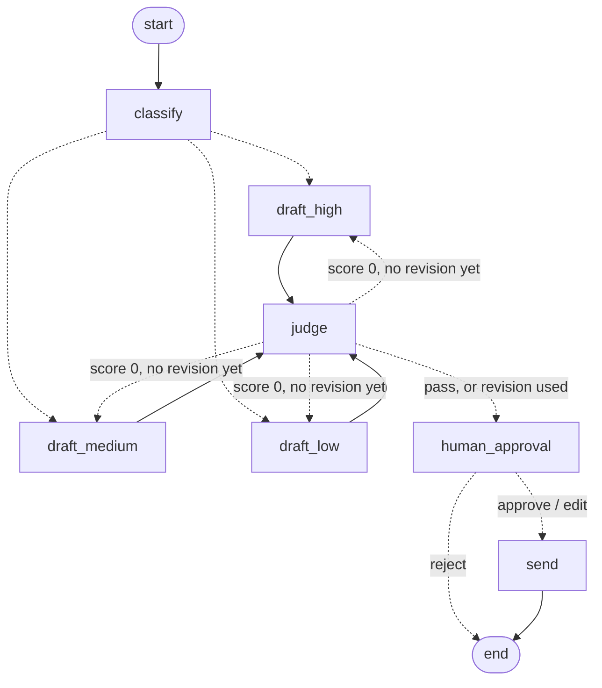

# 🚀 Signup Email Agent

A LangChain agent that processes new user signups, classifies ICP fit, and generates personalized welcome emails — with full LangSmith tracing, a golden eval dataset, and a custom LLM-as-a-Judge scoring pipeline.


## 💡 Use Cases

This agent is a template for any SaaS product that wants to **automatically qualify and engage new signups** without manual effort. Real-world applications include:

- **PLG (Product-Led Growth) onboarding** — trigger a personalized welcome email the moment someone signs up, with messaging tuned to their role and company size
- **Sales prioritization** — route high-ICP signups to a sales rep immediately, low-ICP to a self-serve nurture sequence
- **Marketing automation** — feed ICP scores into your CRM (HubSpot, Salesforce) to segment campaigns without a human reviewing every lead
- **Founder-led sales at early-stage startups** — get a concise "who just signed up and should I reach out?" summary for every new user, automatically

Swap out the Glop branding and ICP criteria for your own product, and this pipeline is ready to wire into a real signup webhook.

### Example: Ledgerline (a made-up company)

*This company and its numbers are made up to show how the agent could be used.*

**The company.** Ledgerline sells payment tools that software teams plug into their apps. People sign up for a free account to try it. Some of them could become big paying customers.

**The problem.**
- About 1,200 people sign up each week, but there are only 3 salespeople.
- The salespeople can't read every signup. A top engineering boss gets the same plain welcome as a student.
- Important leads wait 2–3 days for a personal reply. Some go to a competitor instead.
- Once, an AI email greeted a finance boss with "Hi there" and used the wrong company name. Now a person must check every email before it goes out.

**How the agent helps.**

| Step | What happens at Ledgerline |
|------|----------------------------|
| Sort (ICP fit) | **High:** an engineering or finance leader at a tech company with 50+ people. **Medium:** a developer anywhere. **Low:** students and very small companies. **Unknown:** only an email address. |
| Write | The email fits the person. Leaders hear how it helps their team grow. Developers hear how fast they can start. Everyone else gets a friendly welcome and a how-to guide. |
| Check and fix | A second AI checks each email. If it sounds generic, the agent rewrites it once. |
| Person approves | Each morning, a salesperson looks over the drafts. They can send, change, or throw out each one. |
| Save and wait | A signup at midnight waits safely until someone logs in. |
| Send and record | Approved emails go out. LangSmith keeps a record of every draft, score, and choice. |

**One signup, start to finish.**
1. Tuesday, 11:40 p.m.: Priya, who leads engineering at an 800-person payments company, signs up.
2. The agent marks her as high fit and writes an email about helping her team.
3. The checker gives it a 0 because it forgot her company's name. The agent rewrites it, and it gets a 1.
4. The run pauses and is saved overnight.
5. Wednesday, 9:05 a.m.: a salesperson adds one line and approves it.
6. Priya gets a personal email that morning instead of 3 days later.

**What could change** (made-up goals):

| | Before | Goal |
|---|---|---|
| Time until a top lead gets a personal reply | 2–3 days | The same morning |
| Time salespeople spend on small signups | Most of the week | A few minutes a day |
| Emails with the wrong name or a plain greeting | Nobody knows | Almost none |
| Record of who approved each email | Search old emails | Every approval saved in LangSmith |

**The big idea:** let the AI do the reading and writing, but keep a person in charge of what gets sent. The same idea works for welcoming new bank clients, answering help tickets, or changing important records.

---

## ⚠️ The Problem With Shipping AI Without Evals

Most AI agents get shipped with vibes-based quality control. You run it a few times, it looks good, you push to prod. Then three weeks later someone notices the emails sound generic, the classifications are wrong, and nobody knows when it broke.

"Simple" agents still fail in subtle ways:
- A VP of Engineering gets a generic "leverage our tools" email
- A user with no first name gets "Hi ,"
- A CEO at an 8-person startup gets classified the same as a developer at a 500-person company

These aren't crashes. They're quality failures — and without an eval pipeline, you'll never know they're happening. This project shows how to build the eval layer that catches them.

---

**Stack:** LangChain · LangGraph · LangSmith · DeepEval · OpenAI gpt-4o-mini · Python 3.10+


---

## 📁 Project Structure

```
langsmith-signup-email-agent/
├── agent.py          # Agent definition, structured output schema,
│                     # golden dataset, and LLM-as-a-Judge
├── graph_agent.py    # Same agent as a LangGraph graph with a revise
│                     # loop and human approval
├── eval.py           # DeepEval suite against the LangSmith dataset
├── graph_eval.py     # LangSmith experiment: graph_agent.py vs the
│                     # same golden dataset
├── images/           # README diagrams and LangSmith screenshots
├── requirements.txt
├── .env.example      # Copy to .env and fill in keys
├── .env              # Your real keys — git-ignored
└── .gitignore
```

---

## 🏗️ Architecture


Each signup goes through two LLM calls. The agent call classifies ICP fit and writes the email, returned as a Pydantic structured output (`SignupEmailOutput`). A separate LLM-as-a-Judge call then scores personalization (0 / 1 / n/a). LangSmith traces both calls.

---

## ⚙️ Setup

**1. Install dependencies**
```bash
pip install -r requirements.txt
```

**2. Configure environment**
```bash
cp .env.example .env
# Edit .env and fill in your keys
```

Your `.env` should look like:
```
OPENAI_API_KEY=sk-...
LANGSMITH_API_KEY=lsv2_pt_...
LANGCHAIN_PROJECT=langsmith-signup-email-agent
```

---

## 🚀 Usage

**Run the agent + full eval suite**
```bash
# Keys are loaded from .env automatically
python agent.py
```

This runs all 6 golden dataset test cases, prints each email, and scores each one with the LLM-as-a-Judge.

**Expected output:**
```
============================================================
TEST: Baseline - High ICP
============================================================
ICP Fit:  high
Subject:  Welcome to Glop, Victor! Elevate Your Engineering Team
Body:
  Hi Victor, Welcome to Glop! As the VP of Engineering at Acme Corp...

⚖️  Personalization Score: 1 — Addresses user by name, role, and company context.

...

PERSONALIZATION SCORE SUMMARY
✅  Baseline - High ICP: 1
✅  Edge: Missing first name: 1
✅  Edge: Generic email domain: 1
✅  Edge: Unclear role: 1
✅  Edge: Stealth company: 1
⏭️   Edge: Incomplete context: n/a

Total: 5/5 (excluding n/a cases)
```

---

## 🧠 How It Works

### 1. ICP Classification
**ICP** stands for **Ideal Customer Profile** — a description of the type of company or person most likely to get value from your product and become a long-term customer. In a SaaS context, ICP fit is used to prioritize sales and marketing effort: high-fit signups get white-glove outreach, low-fit signups get a lighter touch.

The signup is sent to the model as plain `key: value` text. There's no input model, so the edge cases (missing name, email only) reach the model as they are. Pydantic is used on the **output**: `SignupEmailOutput` limits `icp_fit` to the four tiers below and returns `to`, `reason`, `subject` and `body` as a validated object:


| ICP fit | Rule | Example from the test cases | Typical treatment |
|---------|------|-----------------------------|-------------------|
| `high` | Engineering/product leader at a tech or SaaS company, 50+ employees | Victor, VP of Engineering, Acme Corp (500 people) | Personal sales outreach — a possible team account |
| `medium` | Developer or technical role at any company | John, Developer; a Software Engineer at TechCorp | Self-serve onboarding for individual developers |
| `low` | Non-technical role or company < 10 employees | Alex, Associate; Maya, CEO of an 8-person startup | Friendly automated welcome, no sales push |
| `unknown` | Insufficient information | A signup with only an email address | Generic welcome, maybe ask for more details |

Sales and marketing time is limited, so ICP fit decides who gets which treatment. In this project it also picks the email's **tone**: team productivity for high, developer speed for medium, warm and simple for low or unknown. In `graph_agent.py`, that's the `route_by_tone` decision that chooses `draft_high`, `draft_medium` or `draft_low`.

### 2. Email Generation
Emails are generated with ICP-tier-specific value props:
- **High** → team productivity, scaling, engineering velocity
- **Medium** → individual developer workflow and speed
- **Low** → warm, simple, no jargon — always uses first name if provided
- **Unknown** → generic and inviting

### 3. LLM-as-a-Judge
After each email is generated, a second LLM call (`judge_personalization()`) scores personalization quality. It sees only the signup and the email body, and scores against fixed rules rather than a stored reference answer. In `graph_agent.py`, the same judge decides whether a draft gets one rewrite:


```
Score 1   → name used + role/company referenced + context-specific value prop
Score 0   → generic greeting when name available, or role/company ignored
Score n/a → no personalizable data existed in the input (not a failure)
```

---

## 🧪 Evaluation Strategy: Online vs Offline

This project implements both types of eval that matter in production AI systems.

### Offline Eval — run manually before shipping a prompt change

```powershell
# Option 1: agent.py golden dataset (custom LLM judge, runs locally)
python agent.py

# Option 2: eval.py DeepEval suite (pulls from LangSmith dataset, uses DeepEval metrics)
python eval.py

# Option 3: graph_eval.py — the LangGraph version, recorded as a LangSmith experiment
python graph_eval.py
```

**What it is:** Batch evaluations against the 6 golden test cases. `agent.py` scores each email with the custom `judge_personalization()` (1 pass, 0 fail, or n/a). `eval.py` pulls the dataset from LangSmith and scores ICP fit and email quality with DeepEval GEval metrics. `graph_eval.py` is covered in the [LangGraph section](#offline-eval-for-the-graph).

**Purpose:** Give you a reproducible, before/after comparison when you change the prompt. These are essentially unit/integration tests for your agent — run them before every deployment to catch regressions.

The golden dataset lives in LangSmith and contains all 6 test cases with their reference outputs:


**Result: 5/5 ✅** (1 n/a excluded)

### Online Eval — no command needed, runs automatically

```
# Nothing to run — just invoke the agent normally and LangSmith scores it automatically.
python agent.py          # or any production invocation (webhook, API call, etc.)
```

Results appear in the **LangSmith dashboard** under your project's traces — not in the terminal.

**What it is:** A LangSmith Online Evaluator (`personalization_quality`) configured to run on traces from the `langsmith-signup-email-agent` project. After every agent run, LangSmith automatically scores the output and attaches a `true/false` feedback tag to the trace.

**Sampling rate:** Set to 100% for development. In production, **10% is recommended** — this gives statistically significant quality metrics without paying for an evaluator LLM call on every single user interaction. Evaluators are LLM calls too: in the week of Oct 19–25, 2026, the four evaluators cost $4.83 across 406 runs, while the agent itself cost $0.01.

**Known gap:** in `agent.py`, the agent call and the judge call are each their own root trace, so the online evaluator also scores the judge's calls. In production, filter the rule to agent runs only.

**LangSmith configuration:**
- **Evaluator:** OnlineEval → `personalization_quality`
- **Feedback key:** `personalization_quality` (Boolean)
- **Sampling rate:** 100% (dev) → 10% (production recommended)
- **Source:** `langsmith-signup-email-agent` project, all Runs

Four LLM-as-a-Judge evaluators run on the project's traces in LangSmith — `personalization_quality` for quality, plus `pii_leakage`, `prompt_injection` and `code_injection` for safety (see [Safety Evaluators](#️-safety-evaluators)):


How traces flow from the scripts into LangSmith, through the evaluators, and back into the golden dataset:


### Why you need both

| | Offline (agent.py) | Online (LangSmith) |
|---|---|---|
| **When it runs** | Manually, before shipping a change | Automatically on every invocation |
| **What it catches** | Prompt regressions before they ship | Production drift and live failures |
| **Output** | Aggregate pass rate in terminal | Per-run score in LangSmith traces |
| **Best for** | Iterating on the prompt confidently | Monitoring quality over time |

Offline eval tells you if your changes made things better or worse before you ship. Online eval tells you if things break in production. You need both.

---

## 🔄 The Continuous Improvement Loop

```
01 DEVELOPMENT
   Run offline evals in agent.py against the golden dataset
        ↓
02 DEPLOYMENT
   Deploy agent (e.g. webhook, Cloud Run, API)
        ↓
03 MONITORING
   LangSmith Online Evaluator scores live traces automatically
   Recommended sampling rate: 10% in production
        ↓
04 REFINEMENT
   Export production failures → add to golden dataset
   Fix prompt → re-run offline evals → confirm improvement
        ↓ (loop)
```

**Key insight:** Errors identified in production traces should be exported back into the golden dataset. This creates a feedback loop where your offline test suite gets stronger every time something breaks in prod.

---

## 🛡️ Safety Evaluators

Beyond quality, three additional online evaluators run automatically in LangSmith:

| Evaluator | What it flags | Response |
|-----------|--------------|----------|
| **PII Leakage** | Sensitive personal data appearing in agent input | Routes trace to human review queue via LangSmith Automation |
| **Prompt Injection** | Attempts to hijack the agent via malicious input | Flags trace with `prompt_injection: true` |
| **Code Injection** | Code-based attack patterns in input | Flags trace with `code_injection: true` |

When `pii_leakage: true` fires, a LangSmith automation rule (PII Alert) routes the trace to `pii-review-queue` — no manual monitoring required. Because every signup contains a name and an email, `pii_leakage` currently flags most traces; in production you'd tune it to flag only unexpected PII.

Safety and quality are separate concerns. Build separate evaluators for each; don't combine them into one judge.

---

## 💡 Key Takeaways

1. **Evals aren't optional for production AI.** Without them, you're flying blind — no way to know if your agent is getting better or worse as you iterate.

2. **Start with a golden dataset.** Even 5–6 examples covering your known edge cases catches most regressions. Add to it every time something breaks in prod.

3. **Online + offline evals serve different purposes.** Offline tells you if your changes made things better before you ship. Online tells you if things break after you ship. You need both.

4. **LLM-as-a-Judge beats exact match.** Reference outputs get stale. A well-prompted judge that evaluates against clear criteria is more robust and easier to maintain.

5. **Safety and quality are separate concerns.** Build separate evaluators for each — don't try to combine them into one judge.

---

## 🕸️ LangGraph Version: Revise Loop + Human Approval

`graph_agent.py` rebuilds the agent as a LangGraph graph. It drafts on its own, but nothing is sent without a person approving it.




| Step | What it does |
|------|--------------|
| `classify` | Structured output returns the ICP fit and reason |
| `draft_high` / `draft_medium` / `draft_low` | A conditional edge picks the tone from the ICP fit (unknown uses the low tone) |
| `judge` | The existing `judge_personalization()` scores the draft. A 0 sends it back with the judge's feedback, **one revision max** |
| `human_approval` | `interrupt()` pauses the run and shows the draft |
| `send` | Stub — appends the approved email to `outbox.jsonl`. Nothing is really sent |

Every step reads and writes one shared state, `SignupState`:

| Field | Type | Holds | Written by |
|-------|------|-------|------------|
| `signup` | `str` | Raw signup, one `key: value` per line | Caller, at start |
| `weak_first_draft` | `bool` | Demo flag: force a generic first draft | Caller, at start |
| `icp_fit` | `str` | `high`, `medium`, `low` or `unknown` | `classify` |
| `reason` | `str` | One-sentence reason for the fit | `classify` |
| `subject` | `str` | Email subject | `draft_*` |
| `body` | `str` | Email text | `draft_*`, or the person on `edit` |
| `judge_score` | `int \| str` | `1`, `0` or `"n/a"` | `judge` |
| `judge_feedback` | `str` | Judge's reason, passed to the rewrite | `judge` |
| `revision_count` | `int` | Rewrites so far (0 or 1) | `classify` sets 0; `draft_*` adds 1 on a rewrite |
| `decision` | `str` | `approve`, `edit` or `reject` | `human_approval` |

A judge score of 0 sends the draft back to the **same** draft step it came from (for Alex, `draft_low`), once. A score of 1 or n/a, or a 0 after the rewrite, goes to `human_approval`.

Runs are checkpointed to SQLite (`checkpoints.sqlite`) by `thread_id`, so a paused run can be resumed later from a separate process. Every step is its own span in LangSmith, and the start and resume traces share the `thread_id`.

```powershell
# Run a signup until it pauses for approval
python graph_agent.py --case alex --weak-first-draft

# Resume it later with the thread_id it prints
python graph_agent.py --resume <thread_id> approve
python graph_agent.py --resume <thread_id> edit --body "Hi Alex, ..."
python graph_agent.py --resume <thread_id> reject
```

`--weak-first-draft` forces a generic first draft so the judge fails it and the revise loop is visible. Without it, the current prompt usually passes on the first try. Other options: `--case` (`victor`, `no-name`, `john`, `alex`, `maya`, `minimal`), `--signup "<custom fields>"`, and `--diagram` to print the graph as Mermaid.

### Offline eval for the graph

```powershell
python graph_eval.py
```

Runs the graph against the same LangSmith golden dataset, stopping at the approval step, and records a LangSmith **experiment** (`graph-agent-…`) under Datasets & Experiments. Each run gets four scores:

| Metric | Checks |
|--------|--------|
| `icp_fit_match` | `classify` matches the dataset's reference `icp_fit` |
| `personalization` | Final judge score after the revise loop (n/a skipped) |
| `needed_revision` | The first draft failed and was rewritten — a rising rate means the draft prompt is getting worse |
| `paused_for_approval` | The run stopped at `human_approval` and sent nothing |

First result: ICP fit 6/6, personalization 5/5, revisions 0/6, paused 6/6.


---

## 🛠️ Troubleshooting

### LangSmith 403 Forbidden
Check `LANGSMITH_API_KEY` in `.env`. A key set in your terminal takes priority over `.env` (`load_dotenv()` doesn't override existing variables), so clear an old one:
```powershell
Remove-Item Env:LANGSMITH_API_KEY
python agent.py
```

### KeyError in LangSmith Evaluator
A common error where the evaluator expects a specific JSON key (e.g. `outputs_one`) that doesn't match the actual trace structure. Fix: open a failing trace in LangSmith, inspect the raw JSON output, and verify the top-level key names match what your evaluator prompt references via `{{output}}`.

### Simulating Failures to Test the Feedback Loop
Two reliable ways to generate failures for testing:
- **Prompt degradation** — temporarily weaken the system prompt (e.g. remove the name/role instructions) to produce generic emails that score 0
- **Data edge cases** — introduce malformed inputs (missing name, generic domain, incomplete context) into the test set — these are already covered in the golden dataset

### Dataset Count Mismatch
If your local example count doesn't match what LangSmith shows, this is likely a caching or sync issue. Refresh the LangSmith dataset page and re-run to force a fresh fetch.

---

## 🌐 Framework Compatibility

This project uses **LangChain + LangSmith**, which are tightly coupled and the recommended pairing for LangChain-based agents.

For teams using other frameworks:

| Framework | Observability | Offline Eval |
|-----------|--------------|--------------|
| LangChain | LangSmith (native) | `judge_personalization()` in agent.py |
| Google ADK | OpenTelemetry | DeepEval (native ADK integration) |
| Custom agents | LangSmith or LangFuse via OpenTelemetry | DeepEval |

**Recommendation:** Choose an observability platform that actively tracks the release cycle of your underlying framework. For LangChain users, LangSmith is the natural choice.

---

## 📊 Eval Results

### Personalization Score: 5/5 ✅
*(1 n/a case excluded — no personalizable data in input)*

| Test Case | ICP Fit | Score | Notes |
|-----------|---------|-------|-------|
| Baseline — High ICP (Victor, VP Eng) | high | ✅ 1 | Name + role + company used |
| Missing first name | medium | ✅ 1 | Fell back to role + company |
| Generic email domain (gmail) | medium | ✅ 1 | Used first name + role |
| Unclear role (Associate, 25 ppl) | low | ✅ 1 | Used first name, warm tone |
| Stealth company (CEO, 8 ppl) | low | ✅ 1 | Used first name |
| Incomplete context (email only) | unknown | ⏭️ n/a | No data to personalize |

---

## 📈 Before vs After Prompt Improvement

| | Before | After |
|---|---|---|
| **Subject** | "Welcome to Glop, Victor!" | "Welcome to Glop, Victor! Elevate Your Engineering Team" |
| **Body** | Generic "leverage our tools" | Role-specific: engineering velocity, scaling |
| **CTA** | "Feel free to reach out" | "Explore your dashboard to get started" |
| **Word limit** | 150 words | 120 words |
| **Low ICP fallback** | Dropped name | Always uses first name if provided |
| **Eval score** | 4/6 (before prompt fix) | 5/5 ✅ |

---

## 📏 Evaluation Metrics

| Metric | Type | Tool | Result |
|--------|------|------|--------|
| ICP fit classification | Structured output | Pydantic + GPT-4o-mini | ✅ All cases correct |
| ICP fit quality | GEval LLM judge | DeepEval + GPT-4o-mini | 0.78–0.80 avg ✅ (varies per run) |
| Personalization quality (offline) | LLM-as-a-Judge (0/1/n/a) | `judge_personalization()` in agent.py | 5/5 ✅ |
| Email quality | GEval LLM judge | DeepEval + GPT-4o-mini | 0.73–0.77 avg ✅ (varies per run) |
| LangGraph agent vs golden dataset | LangSmith experiment | `graph_eval.py` | ICP 6/6, personalization 5/5, paused 6/6 ✅ |
| Personalization quality (online) | Boolean (true/false) | LangSmith OnlineEval | ✅ Active, 100% sampling |
| PII leakage detection | Online evaluator | LangSmith | ✅ Active |
| Prompt injection detection | Online evaluator | LangSmith | ✅ Active |
| Code injection detection | Online evaluator | LangSmith | ✅ Active |
| Tracing & observability | Online traces | LangSmith | ✅ Active |

---

## 🔗 Get the Code

The full project is open source. If you're building AI agents and haven't thought about evals yet, this is a good place to start.

👉 [github.com/vfuller1/langsmith-signup-email-agent](https://github.com/vfuller1/langsmith-signup-email-agent)

